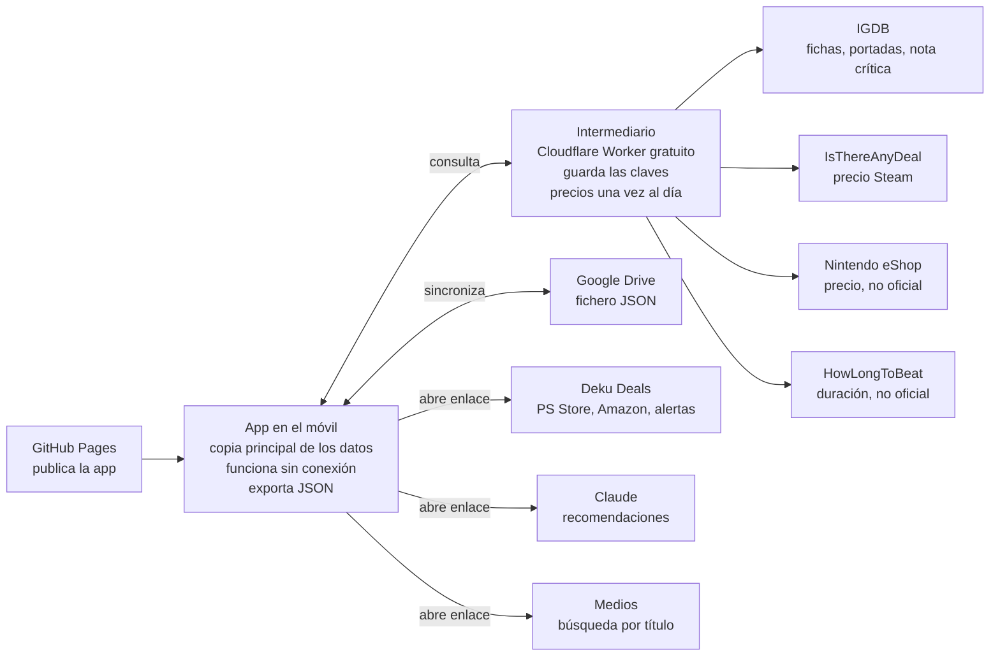

# App de backlog de juegos: diseño funcional

27 de octubre de 2026

## Cómo usar este documento en Claude Code

- Guardar este fichero en la raíz del repositorio y los dos JSON en `/data`: `historico_juegos_2021_2026.json` y `backlog_juegos.json`.
- Construir la fase 1 completa y no abrir la siguiente hasta cumplir su criterio de cierre (ver Roadmap).
- Las decisiones abiertas del final no bloquean la fase 1.
- Coste cero en todo el sistema: no usar servicios de pago ni la API de Claude.

## Objetivo y alcance

Una PWA de uso personal, solo para móvil, que reúne backlog, juegos en curso, histórico y lista de deseos, con análisis de hábitos de juego y precios. Todo el sistema funciona con coste cero.

| Incluido | Fuera de alcance |
| --- | --- |
| Backlog, juegos en curso, histórico y deseados | Versión de escritorio o tablet |
| Fichas con portada y descripción desde IGDB | Funciones sociales o compartir listas |
| Puntuación de 1 a 10 en pasos de 0,25 y reseña corta | Precios de PS Store y Amazon dentro de la app |
| Registro de abandonos con motivo | Notificaciones push |
| Análisis de hábitos | Servicios de pago |
| Precio de Steam y eShop; enlace a Deku Deals para el resto | |
| Sincronización con Google Drive y exportación | |
| Recomendaciones con Claude mediante enlace | Llamadas a la API de Claude desde la app |
| Enlaces a seis medios de videojuegos | Feeds de noticias dentro de la app |

Plataformas: PS5 Pro, Switch 2, AYN Thor, ROG Ally y Retroid. La lista es editable.

## Pantallas y navegación

Cinco pestañas en una barra inferior y un botón fijo para añadir juego. Todo se maneja con una mano.

| Pantalla | Contenido | Acciones |
| --- | --- | --- |
| Inicio | Juegos en curso con horas y días desde la última sesión; resumen del año (terminados, abandonados, nota media) | Actualizar horas, cambiar estado, abandonar en un toque |
| Biblioteca | Lista con portada por estado: Pendiente, Jugando, Pausado, Terminado, Abandonado | Filtrar por plataforma, género y año; ordenar por nota, fecha o título |
| Ficha de juego | Portada, descripción, género, duración, plataforma, partidas, nota, nota de la crítica, reseña y motivo de abandono | Editar, nueva partida, abandonar en un toque, abrir en Deku Deals y en medios |
| Deseados | Juegos no comprados con precio actual, mínimo histórico y precio objetivo | Marcar comprado, fijar precio objetivo |
| Análisis | Métricas y gráficos de hábitos | Filtrar por año y plataforma; pedir recomendación a Claude |
| Ajustes | Plataformas, horas semanales de juego, sincronización, importación y exportación | Sincronizar, exportar JSON, importar datos |

Añadir juego: búsqueda en IGDB por título, selección del resultado correcto, plataforma y estado inicial. Si IGDB no lo encuentra, alta manual con título y portada opcional.

Puntuar: selector de 1 a 10 en pasos de 0,25, en la ficha y al cerrar una partida.

Abandonar en un toque: botón en la ficha y en Inicio. Pasa la partida a Abandonado y guarda fecha y horas al momento; motivo, nota y si retomarlo quedan como opcionales. Se graba en el dispositivo sin esperar a la sincronización.

## Modelo de datos

El juego y la partida son entidades separadas: un mismo juego puede tener varias partidas con estados y notas distintas. El histórico ya lo necesita, con Final Fantasy VII Remake terminado en 2023 y abandonado en 2026.

**Juego**

| Campo | Tipo | Origen |
| --- | --- | --- |
| `id` | texto | App |
| `igdb_id` | número | IGDB |
| `titulo` | texto | IGDB o manual |
| `portada_url` | texto | IGDB |
| `descripcion` | texto | IGDB |
| `generos` | lista | IGDB |
| `hltb_principal_h`, `hltb_extras_h`, `hltb_completo_h` | número | HowLongToBeat; si falla, IGDB |
| `steam_appid`, `eshop_nsuid` | texto | Búsqueda en tienda, confirmada por el usuario |
| `enlace_deku` | texto | Guardado al confirmar la ficha en Deku Deals |
| `nota_critica`, `fuente_critica` | 1 a 10, texto | IGDB, convertida a escala de 10 |
| `enlace_hltb`, `enlace_metacritic` | texto | Guardado al confirmar la ficha |

**Partida**

| Campo | Tipo | Regla |
| --- | --- | --- |
| `id`, `juego_id` | texto | App |
| `plataforma` | lista cerrada | Obligatorio |
| `estado` | lista cerrada | Obligatorio |
| `fecha_inicio`, `fecha_fin` | fecha | `fecha_fin` obligatoria en Terminado y Abandonado; en el histórico basta el año |
| `horas` | número | Opcional |
| `nota` | 1 a 10, pasos de 0,25 | Permitida también en Abandonado |
| `completado_100` | sí o no | Solo en Terminado |
| `resena` | texto corto | Opcional |
| `motivo_abandono` | lista múltiple | Solo en Abandonado |
| `retomar` | sí, no o quizá | Solo en Abandonado |
| `horas_estimadas_min`, `horas_estimadas_max` | número | Estimación propia; si falta, se usa la de HowLongToBeat |

**Deseado**: `juego_id`, plataforma prevista, precio objetivo, precio actual, mínimo histórico, tienda y fecha de la última consulta.

**Estados de partida**

| Estado | Significado |
| --- | --- |
| Deseado | No comprado; consulta precio |
| Pendiente | Comprado, sin empezar |
| Jugando | En curso |
| Pausado | Aparcado con intención de volver |
| Terminado | Historia acabada, con o sin 100% |
| Abandonado | Dejado sin terminar |

Motivos de abandono: lento, repetitivo, la historia no engancha, demasiado difícil, demasiado fácil, abrumador, falta de tiempo, desplazado por otro juego y otro. Se pueden marcar varios.

## Integraciones

Nueve integraciones, todas gratuitas. Las que necesitan clave pasan por el intermediario, para que ninguna clave quede en el navegador.

| Integración | Uso | Acceso | Riesgo |
| --- | --- | --- | --- |
| IGDB | Búsqueda, portada, descripción, géneros, duración, nota de la crítica | Cuenta gratuita de Twitch; vía intermediario | Bajo |
| IsThereAnyDeal | Precio actual y mínimo histórico en Steam, región España | Clave gratuita registrando la app; vía intermediario | Bajo |
| Precios de Nintendo eShop | Precio actual en eShop España por identificador del juego | Servicio no oficial, sin clave | Medio: si falla, se muestra el enlace a Deku Deals |
| Deku Deals | Precios de PS Store, Amazon y resto de tiendas; alertas | Enlace a la ficha, sin API | Bajo |
| Google Drive | Sincronización del fichero de datos | OAuth de Google, permiso solo sobre ficheros creados por la app | Bajo |
| HowLongToBeat | Duración principal, con extras y al 100% | Servicio interno no oficial, sin clave; vía intermediario y guardado al dar de alta | Medio: si falla, se usa la duración de IGDB o la estimación propia |
| Nota de la crítica | Nota media de la crítica y enlace a Metacritic | Nota agregada de IGDB, con la misma clave | Bajo |
| Claude | Recomendaciones a partir del backlog y las tendencias | Enlace que abre Claude con un resumen precargado; sin API | Bajo: el texto se copia también al portapapeles |
| Medios | Noticias y análisis de cada juego | Enlaces de búsqueda por título en seis medios | Bajo |

Reglas de precio:

- Solo se consultan juegos en estado Deseado.
- El intermediario actualiza precios una vez al día y guarda el resultado; la app lee de ahí.
- Si el precio actual es igual o inferior al objetivo, el juego se marca en Deseados y en Inicio.
- Enlace a Deku Deals: la primera vez abre la búsqueda por título; al confirmar la ficha correcta se guarda el enlace directo.

Referencias: la API pública de Deku Deals sigue como petición de usuarios, sin fecha ([Deku Deals](https://www.dekudeals.com/feature-requests)). HowLongToBeat no ofrece API pública y las librerías que usan su servicio interno se rompen cuando cambia ([hltb-client](https://socket.dev/npm/package/hltb-client), [incidencia en la librería de Python](https://github.com/ScrappyCocco/HowLongToBeat-PythonAPI/issues/52)). IGDB publica su propio dato de duración, con menos cobertura ([GameVault](https://gamevau.lt/docs/server-docs/metadata-enrichment/provider-igdb/)). La API oficial de Metacritic es de pago ([Fabric Origin](https://knowledgebase.fabricdata.com/origin/apis-all/metacritic-api-docs)), por eso se usa la nota de IGDB.

**Recomendaciones con Claude.** Botón en Análisis que prepara un resumen y abre Claude con él escrito, listo para enviar.

- Contenido: pendientes con duración y género, juegos con 9 o más, tasa de abandono por género, motivos más repetidos y horas semanales disponibles.
- Apertura: enlace `https://claude.ai/new?q=<texto codificado>`; a la vez se copia al portapapeles por si la app de Claude no lo recoge.
- Límite: el texto precargado se corta hacia los 14.000 caracteres ([Claude Desktop](https://support.claude.com/en/articles/14729294-open-claude-desktop-with-a-link)), así que el resumen va compactado y sin el histórico completo.
- Coste: ninguno; no usa la API y la conversación queda en la cuenta de Claude del usuario.

La apertura de un chat con texto precargado en la app del iPhone no está documentada; la ayuda oficial solo lo cubre para Claude Code ([Claude móvil](https://support.claude.com/en/articles/14898120-open-the-claude-mobile-app-with-a-link)). Se valida en la fase 2; el portapapeles cubre el caso de que no funcione.

**Enlaces a medios.** En la ficha, una fila de seis enlaces. Cada uno abre una búsqueda del título limitada a ese medio, sin depender del buscador de cada web. Dominios por validar en la fase 1.

| Medio | Dominio |
| --- | --- |
| Vandal | vandal.elespanol.com |
| 3DJuegos | 3djuegos.com |
| Eurogamer | eurogamer.es |
| IGN España | es.ign.com |
| Meristation | as.com/meristation |
| Hobby Consolas | hobbyconsolas.com |

## Análisis

El análisis se centra en cuándo y por qué se abandona un juego. Con el histórico actual, la tasa de abandono sube del 10% en 2024 al 33% en 2026.

| Año | Terminados | Abandonados | Abandono |
| --- | --- | --- | --- |
| 2021 | 10 | 0 | sin registro |
| 2022 | 12 | 0 | sin registro |
| 2023 | 14 | 0 | sin registro |
| 2024 | 18 | 2 | 10% |
| 2025 | 26 | 8 | 24% |
| 2026 (hasta octubre) | 10 | 5 | 33% |

| Métrica | Para qué sirve |
| --- | --- |
| Tasa de abandono por año, género y plataforma | Ver qué tipo de juego se deja |
| Horas medias antes de abandonar | Saber en qué punto se pierde el interés |
| Motivos de abandono más repetidos | Filtrar la próxima compra |
| Nota media por año, género y plataforma | Ver qué funciona mejor |
| Juegos con 9 o más | Referencia de gustos; hoy son 29 |
| Antigüedad del backlog | Detectar compras que llevan más de 12 meses sin empezar |
| Siguiente juego sugerido | Pendientes de los géneros con mejor nota y menor abandono; regla fija, sin IA |
| Horas reales frente a HowLongToBeat | Ver qué juegos se alargan más de lo previsto antes de abandonarlos |
| Nota propia frente a la crítica | Ver en qué géneros coincide la nota propia con la crítica y en cuáles no |

Para que el análisis por género y plataforma tenga sentido, el histórico necesita la plataforma completada (ver Carga inicial).

## Carga inicial: histórico y backlog

El histórico se carga una sola vez desde `data/historico_juegos_2021_2026.json`: 106 partidas, 90 terminadas, 15 abandonadas y 1 pausada (Persona 5 Royal, 60 horas).

Reglas aplicadas en la normalización:

- Títulos corregidos al nombre oficial para que IGDB los encuentre; se conserva el texto original en `titulo_original`.
- Nota sola: Terminado con esa nota.
- "abn" con nota: Abandonado con nota. "abn" o "drop" sin nota: Abandonado sin nota.
- Fecha: solo el año. Plataforma: vacía, se completa después.
- Final Fantasy VII Remake: dos partidas del mismo juego (2023 terminada, 2026 abandonada).
- Notas convertidas de la escala de 100 a la de 10, redondeando al 0,25 más cercano (72 pasa a 7,25 y 91 a 9). El valor original se conserva en `nota_original_100`.

El backlog se carga desde `data/backlog_juegos.json`: 100 juegos, 99 pendientes y 1 pausado (Baldur's Gate 3, 25 horas).

- Duplicados unificados en una sola entrada; Persona 4 aparecía tres veces y Resident Evil 2 dos.
- Plataformas: Switch pasa a Switch 2, PS5 a PS5 Pro y ASUS a ROG Ally. Retroid entra como plataforma nueva. Se conserva el valor original en `plataforma_original`.
- 46 juegos llevan plataforma y horas estimadas; suman entre 1.040 y 1.181 horas.
- 16 juegos llevan una nota en el campo `revisar` para confirmar en la lista de revisión.

Proceso de importación en la app:

1. Leer los dos ficheros y crear juegos y partidas.
2. Buscar cada título en IGDB y proponer la coincidencia más probable.
3. Mostrar una lista de revisión con los títulos sin coincidencia clara, los marcados con `pendiente_confirmar` y los que tienen `revisar`.
4. Completar la plataforma por lotes: seleccionar varios juegos y asignar una plataforma.

Las portadas se descargan en segundo plano; la importación no espera a que terminen.

## Arquitectura

App estática en GitHub Pages, datos en el móvil y un intermediario gratuito para lo que necesita clave. Se construye por fases, cada una usable por sí sola (ver Roadmap).

El móvil nunca llama directamente a IGDB, IsThereAnyDeal, eShop ni HowLongToBeat: todo pasa por el intermediario, que guarda las claves y los precios del día.

| Pieza | Tecnología propuesta |
| --- | --- |
| App | PWA con React y Vite, instalable en la pantalla de inicio |
| Almacenamiento local | IndexedDB |
| Intermediario | Cloudflare Worker con almacenamiento KV y tarea programada diaria |
| Sincronización | API de Google Drive con permiso solo sobre ficheros de la app |
| Publicación | GitHub Pages desde el repositorio |

## Roadmap

Cuatro fases sin fechas: las tres primeras dejan la app completa y la cuarta recoge las mejoras. Cada fase se cierra con su criterio antes de abrir la siguiente.

| Fase | Contenido | Criterio de cierre |
| --- | --- | --- |
| 1. Base | Biblioteca y ficha, estados y partidas, puntuación de 1 a 10, abandonar en un toque, alta con IGDB, carga de histórico y backlog, exportación JSON, enlaces a medios | Datos cargados con portadas y plataforma completada |
| 2. Datos y análisis | Duración HowLongToBeat, nota de la crítica, motivos de abandono, métricas y gráficos, sincronización con Google Drive, enlace a Claude | Análisis por año, género y plataforma con datos reales |
| 3. Deseados y precios | Lista de deseados, precios de Steam y eShop, precio objetivo, enlaces a Deku Deals | Precios actualizados a diario sin coste |
| 4. Próximas mejoras | Ver tabla siguiente | Orden según uso, tras la fase 3 |

**Próximas mejoras (fase 4)**

| Mejora | Qué hace |
| --- | --- |
| Siguiente juego | Calcula las semanas que costaría terminar cada pendiente, con la duración de HowLongToBeat y las horas semanales indicadas en Ajustes, y propone los que encajan con los géneros mejor puntuados |
| Sagas y orden | Agrupa por saga (God of War, Dragon Quest, Final Fantasy, Persona, Metroid, Zelda) con orden recomendado y progreso |
| Sesión en un toque | Suma horas desde Inicio sin abrir la ficha |
| Aviso de juego parado | Si un juego en Jugando lleva 14 días sin sesión, propone pasarlo a Pausado |
| Resumen anual | Ficha del año con terminados, abandonados, mejores notas y horas |
| Gasto mensual | Registra lo que se gasta cada mes en juegos y lo muestra por mes y por plataforma. Alcance por definir |
| Feeds de noticias (opcional) | Titulares de los seis medios dentro de la app; baja prioridad |

## Decisiones abiertas

- [x] Persona 5 Royal: Pausado con 60 horas.
- [x] Backlog: cargado en `backlog_juegos.json`.
- [x] Nota de la crítica: IGDB, sin Metascore.
- [ ] Prince of Persia: The Lost Crown y American Arcadia: cargados como Abandonado sin nota. Confirmar.
- [ ] 2021 a 2023 no tienen abandonos: confirmar si no los hubo o no se registraban. Si no se registraban, el análisis de tendencia empieza en 2024.
- [ ] Otros abandonos de 2026 fuera de la lista (The Witcher 3 Remastered, Crimson Desert, Final Fantasy XIV): decidir si se añaden.
- [ ] Retroid: confirmar como plataforma nueva. ASUS se ha asumido como ROG Ally.
- [ ] God of War (2018), God of War Ragnarök, Portal y Metroid Prime Remastered ya están terminados en el histórico: rejugada o quitar del backlog.
- [ ] Pragmata, 007 First Light y The Blood of Dawnwalker: confirmar si están comprados o pasan a Deseado.
- [ ] Siete títulos con versión o nombre por confirmar: Persona 3, Dragon Quest I, II, III y VII, Denshattack! y Khazan.
- [ ] Horas semanales de juego para el cálculo de Siguiente juego.
- [ ] Validar el formato del enlace de búsqueda de Deku Deals y la región España (fase 1).
- [ ] Validar los dominios de los seis medios (fase 1) y la apertura de Claude con texto precargado en el iPhone (fase 2).
- [ ] Gasto mensual en juegos: definir qué se registra (precio de compra, fecha, tienda, suscripciones) y en qué fase entra. Encaja con "Marcar comprado" de Deseados (fase 3).
